  

  <a href="assets/hero-static.svg">View the still version</a>

## About Me

I’m a software developer who enjoys turning practical ideas into thoughtful, useful products. My public work spans Windows desktop software, interactive web experiences, and a computer-vision project.

I’m especially interested in the details that make software feel clear and dependable: considered interfaces, useful interactions, and maintainable implementation.

## Tech Stack

The technologies below are drawn from the featured public repositories.

 <strong>Desktop &amp; media:</strong> <code>C#</code> · <code>.NET</code> · <code>WinUI 3</code> · <code>yt-dlp</code>

 <strong>Web:</strong> <code>HTML</code> · <code>CSS</code> · <code>JavaScript</code> · <code>React</code> · <code>Vite</code>

 <strong>Computer vision:</strong> <code>Python</code> · <code>Flask</code> · <code>Ultralytics YOLO</code>

## Featured Projects

Windows media downloader with format and quality options, a queue, and local download history. Built with C#, .NET, WinUI 3, and yt-dlp.

Interactive timeline that connects a person's age with historical events from around the world and Brazil. Built with HTML, CSS, and JavaScript.

Browser-based Truco Paulista with solo bot play and real-time multiplayer. Built with HTML, CSS, and JavaScript.

Compound-interest calculator with an interactive interface. Built with React, Vite, and JavaScript.

Web app that processes uploaded images to detect and count cattle using Ultralytics YOLO, Flask, and Python.

YourLife is also available as a [live web app](https://lucasjordaoreal.github.io/yourlife/).

## GitHub Activity

I keep this profile focused on the work rather than third-party stats widgets. Browse my [public repositories](https://github.com/lucasjordaoreal?tab=repositories) to see projects and activity directly on GitHub.

## Connect With Me

The verified public contact link I currently share is [GitHub](https://github.com/lucasjordaoreal).

  

